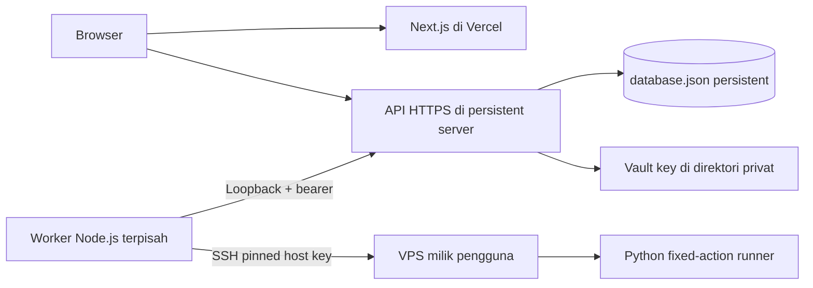

<!-- coderabbit-ai-generated:v1 -->

<!-- coderabbit-ai-generated-section:v1:8b0139341df522f2655fa366e2e482e9a9757abcc3c9e3c8bc01639b7e1ed80e -->

# Arsitektur dan skema data

## Aliran sistem

Development menggunakan rewrite Next.js `/api/*` ke `/v1/*` API loopback. Produksi memakai `NEXT_PUBLIC_API_URL=https://api.example.com/v1` saat build dan frontend `https://app.example.com`; gunakan domain induk yang sama agar cookie SameSite Lax bekerja. API dan worker pada host persisten yang sama dalam versi ini. Endpoint internal 4001 tidak boleh dipublikasikan. Browser tidak memegang worker token atau vault key.

## Penyimpanan versi 1

`schema_version: 1`, `revision` naik setiap transaksi. Semua koleksi berupa array dengan `id`, `user_id`, `created_at` serta field khusus. `lib/contracts.ts` adalah sumber kontrak runtime. Validasi skema saat load dan transaksi mencakup identitas unik, field kritis user/session/job, envelope secret terenkripsi serta penolakan password plaintext dalam record server. Constraint ownership ditegakkan di API. Belum ada foreign key/database engine atau migrasi skema otomatis. Penambahan field sensitif wajib menambah proyeksi response aman.

| Koleksi | Field utama dan tujuan |
|---|---|
| users | email unik, name, password_hash Argon2id, role user/administrator, status, verified_at |
| sessions | token_hash, csrf, expires_at, last_seen_at; token cookie asli tidak disimpan |
| servers | provider, mode, host, pinned ip/port/username/fingerprint, auth, key_id, credential AEAD, facts, recovery_required |
| ssh_keys | name, description, algorithm, public_key, fingerprint, secret AEAD |
| jobs | server_id, type, status, step, progress, logs, idempotency_key/request_digest, lease_epoch/until, config_secret/expiry, result/error |
| installations | job_id, server_id, type, status untuk histori terminal |
| nodes | server_id, node_id, panel_url, fqdn, daemon_port, sftp_port, status unverified sampai ada bukti |
| domains | domain, server_id, DNS addresses/status dan hasil TLS |
| certificates | slot ekstensi; hasil sertifikat saat ini berada dalam metadata domain, bukan private key TLS |
| activity_logs | action, resource_id; tidak menyimpan command, request body atau secret |
| settings | key, value, scope global; registrasi dan maintenance |
| probes | scan/test fingerprint/IP sementara, expiry, input_digest dan facts |
| auth_tokens | hash reset/verification, type, expires_at; single use |
| secrets, plans | slot skema untuk ekstensi, belum dipakai sebagai fitur aktif |

`Store` merupakan batas repository untuk migrasi PostgreSQL. API tidak memanipulasi file secara langsung. Store memakai lock direktori proper-lockfile, antrean promise satu writer, clone snapshot, file temp eksklusif 0600, fsync, rename dan directory fsync. API kedua pada direktori sama ditolak. Kegagalan durable write/lock membuat store berhenti melayani snapshot; operator harus memulihkan storage. Batas file 25 MiB mencegah pertumbuhan tak terbatas; migrasi diperlukan sebelum kapasitas tercapai.

## Job flow

Pending → Connecting → Preparing → Installing → Configuring → Verifying → Completed. Read-only checks dapat langsung masuk Verifying. Failed/Cancelled adalah terminal. Progress berasal dari event runner, bukan timer acak.

Config job dienkripsi dengan grant satu jam, hanya dibuka saat claim, lalu dibuang saat terminal. Duplikat request idempotency mengembalikan job yang sama; key dengan payload berbeda ditolak. Satu job aktif per server. Worker heartbeat 5 detik, lease 45 detik; epoch mencegah update dari worker lama setelah recovery. Lease kedaluwarsa menjadi Failed/recovery_required dan tidak dicoba ulang otomatis. Runner menggunakan flock remote untuk mencegah proses tumpang tindih setelah gangguan jaringan.

Cancellation menghapus job Pending segera, atau dihormati sebelum remote action. Setelah mutasi dimulai, runner menyelesaikan aksi atomik operasionalnya; menghentikan apt/migrasi secara paksa tidak diimplementasikan. UI menyebut ini cancellation request, bukan menjanjikan rollback. Job tetap berjalan saat browser ditutup. Hanya job read-only yang memiliki retry langsung; perubahan remote membutuhkan review dan persetujuan baru.

SSE `/v1/jobs/:id/events` mengirim progress yang sudah disimpan, heartbeat dan snapshot saat reconnect. UI memakai polling 6 detik sebagai mekanisme pembaruan, sehingga tidak bergantung pada tab awal. Log runner hanya tahap dan error tersaring; stdout/stderr command tidak diteruskan mentah.

<!-- /coderabbit-ai-generated:v1 -->